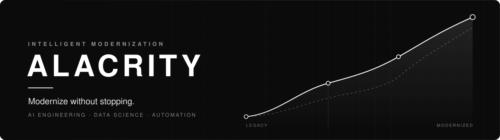

  

  
  
  

## About

Alacrity modernizes the systems organizations already run, using AI engineering, data science and automation. We keep what works, redesign what slows you down, and build an intelligent layer on top, without stopping the work.

We study how your operation really works, then design and build the pieces that are missing. The result is a durable system your team can run, measure and improve long after delivery.

## What we build

| Area | Focus |
| :-- | :-- |
| **AI Engineering** | Production AI systems and agents built around your processes |
| **Data Science** | Reliable analysis and forecasts, with assumptions everyone can see |
| **Automation** | Repetitive manual work turned into monitored, auditable workflows |
| **Intelligent Systems** | Decision-support layers added on top of the systems you already use |
| **Forecasting & Optimization** | Planning and resource decisions driven by measurable models |
| **Software Development** | Maintainable software engineered for real operating conditions |
| **Systems Integration** | Disconnected tools and data sources joined into one picture |
| **Infrastructure Modernization** | Legacy platforms upgraded step by step, with no big-bang cutover |

## From legacy systems to intelligent operations

| Before | After |
| :-- | :-- |
| Disconnected systems | Integrated systems |
| Manual, repetitive work | Automated processes |
| Scattered data | Organized, decision-ready data |
| Slow operations | Faster, measurable operations |

**How we work:** Assess, Design, Build, Integrate, Improve. Every decision and its alternatives are written down, so project knowledge is not lost when people change.

## Product: Flux

**From a fully human company to a human + AI organization.**

Flux gives each department AI assistants with clearly defined responsibilities, just like an org chart. Managers set goals, budgets and limits of authority, and a person always gives the final approval.

- Installed on your own infrastructure or a dedicated environment you control
- Budget caps for the whole company, each department and each task
- Sensitive actions such as payments, deletions or publishing require human approval
- A full record of every action, cost and approval

*Status: demo, accepting pilot partners.* [Learn more at alacrity.agency](https://www.alacrity.agency/#/products)

## How we make decisions

1. **Deep work over visible busyness.** We protect uninterrupted time for difficult technical work.
2. **Ownership over hand-offs.** The person closest to the problem has the context and authority to improve it.
3. **Evidence over hierarchy.** Strong decisions are supported by tests, data and clear reasoning.
4. **AI as a collaborator.** Agents handle repeatable work; humans retain judgment and accountability.

## Work with us

Tell us about the systems you use today and the result you expect. We reply within two working days.

- **Projects and partnerships:** [business@alacrity.agency](mailto:business@alacrity.agency)
- **General enquiries:** [info@alacrity.agency](mailto:info@alacrity.agency)
- **Careers:** [alacrity.agency/#/careers](https://www.alacrity.agency/#/careers)

 

  Client and product source code is kept in private repositories. &copy; 2026 Alacrity Agency

